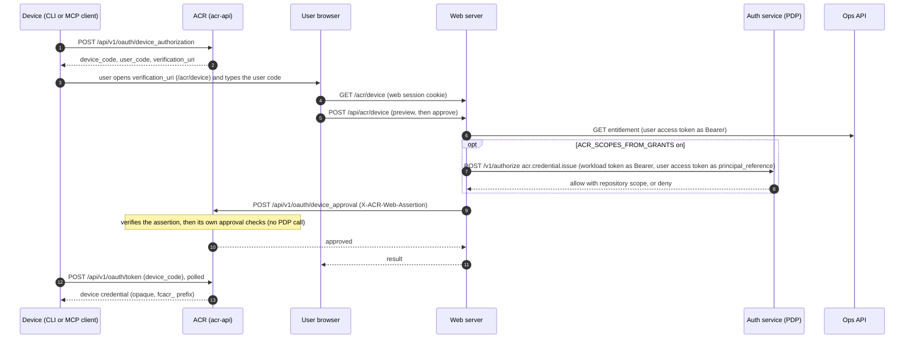
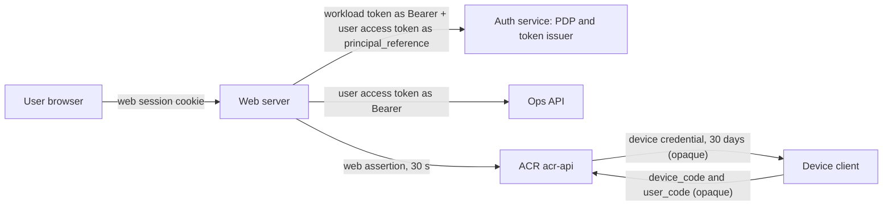

# ACR device approval: how web, ACR and the PDP work together

This page shows how a device (a command line tool or an MCP client) gets an ACR credential after a
person approves it in the web app, which parts take part, which signed tokens move between them, and
what happens when the answer is no. It states what the code does on 2026-11-11. The assertion format
and key custody are in [auth-web-reference.md](auth-web-reference.md), section 3; the key rotation
order is in [auth-endpoint-profiles.md](auth-endpoint-profiles.md), section "Rotating the web
assertion key". The diagram source sits next to the code in
`src/lib/acr/device-approval-architecture.md`; change both together.

## 1. Overview

- The device starts the grant at ACR and gets a user code. It has no browser session.
- The person opens the web approval page, signs in to web, and types the user code. The browser holds
  only the web session cookie. It never holds an ACR credential.
- Web checks entitlement with Ops and, when `ACR_SCOPES_FROM_GRANTS` is on, asks the policy decision
  point (PDP) whether this person may issue an ACR credential.
- Web signs a short assertion and sends the approval to ACR. ACR verifies the assertion, applies its
  own approval checks and marks the grant approved. ACR does not call the PDP for the approval.
- The device polls ACR with its device code and receives the device credential.

## 2. Sequence

## 3. Components and tokens

| Token                                    | Signer                                                       | Verifier                                                      | Audience                                    | Lifetime                              |
| ---------------------------------------- | ------------------------------------------------------------ | ------------------------------------------------------------- | ------------------------------------------- | ------------------------------------- |
| Web session cookie                       | web (Auth.js)                                                | web                                                           | none                                        | not part of this flow                 |
| User access token (EdDSA, `at+jwt`)      | auth service                                                 | PDP (as `principal_reference`) and Ops API (entitlement read) | `dev-health-api`                            | at most 60 minutes (setting: 5 to 60) |
| Workload token (`workload+jwt`)          | auth service, by exchange of the pod's service-account token | PDP route `/v1/authorize`, for admitted callers only          | `auth-service`                              | at most 300 s                         |
| Web assertion (EdDSA, `JWT`, with `kid`) | web, one Ed25519 key file                                    | ACR                                                           | `ACR_WEB_ASSERTION_AUDIENCE` (ACR compares) | 30 s, with 5 s clock skew             |
| Device code and user code                | ACR (opaque, not signed)                                     | ACR (stored as hashes)                                        | none                                        | 10 minutes                            |
| Device credential (`fcacr_` prefix)      | ACR (opaque, not signed)                                     | ACR on later calls                                            | none                                        | 30 days                               |

`sid` and `impersonating` are signed into the assertion only when `ACR_OAUTH_ISSUER` is set on web.
Without it the assertion carries neither, and ACR treats `sid` as optional.

## 4. Why web is in the path

The web assertion is not new work. It dates from mid-July 2026. Device approval was built on it in
late July 2026, and OAuth consent has used it since 22 September 2026. The plan of record for
authorization keeps this request-bound assertion for web context, evidence and approval calls.

Web is in the path because ACR holds no credential from the browser. The browser has the web session
cookie only, and ACR has no user session of its own. The one way ACR learns that a signed-in person
approves this code for this organization and these repositories is a statement signed by web.

What would replace it: the browser calls ACR itself with an OAuth 2.1 token that the auth service
issues, bound to the user and the session. Then web is no proxy on this path and the approval
assertion can go. That path is planned and is not built on 2026-11-11.

Until then, with `ACR_SCOPES_FROM_GRANTS` on, web's own PDP decision (section 7) is the control on this path. ACR applies its own checks
(section 10). A PDP check inside ACR would be defence in depth, not a replacement for the decision in
web.

## 5. The flow

1. The device shows a user code (8 characters). The user enters it in the browser.
2. `POST /api/acr/device` (`src/app/api/acr/device/route.ts`) first checks the `Origin` header, then
   runs one of two calls:
    - preview: `previewDeviceAuthorization` sends `device_approval_preview_request.v1` with the user
      code;
    - approve: `approveDeviceAuthorization` sends `device_approval_request.v1` with the user code
      and `repository_scopes`.
3. Both calls go through `freshIssuance(..., "device")` in `src/lib/acr/service.ts`, which returns
   the authorization for one `credential:issue` request.
4. Web signs an assertion (`signWebAssertion`, `src/lib/acr/assertion.ts`) and sends the request to
   ACR in the `X-ACR-Web-Assertion` header. The assertion lives 30 s.

Each call reads the session and the Ops impersonation status again. A context is never reused, so
an impersonation that starts between a preview and its approval refuses the approval.

## 6. The switch: `ACR_SCOPES_FROM_GRANTS`

| Switch                              | What decides the approval                                                                                                           |
| ----------------------------------- | ----------------------------------------------------------------------------------------------------------------------------------- |
| Off (default)                       | The legacy authorization. No decision is asked. Any organization session that is not impersonating may approve.                     |
| On (`1` or `true`, any letter case) | The impersonation refusal first, then the PDP action `acr.credential.issue` decides, and the repository scopes come from decisions. |

With the switch on, a missing transport or an answer that is not valid refuses the request
(`unavailable`, retryable). There is no fallback to the legacy rule while the switch is on.

## 7. The approver decision (switch on)

`decideCredentialIssue` (`src/lib/acr/grantScopes.ts`) asks the PDP for `acr.credential.issue` on the
session organization. The user's own access token is the principal reference. The outcome decides
the scopes (`resolveDecidedIssuanceScopes`, `src/lib/acr/ops.ts`):

| PDP answer                                    | Request            | Result                                                                             |
| --------------------------------------------- | ------------------ | ---------------------------------------------------------------------------------- |
| Deny                                          | any                | 403 `not_entitled`, "Approval is unavailable for this account."                    |
| Deny, reason `repository_allowlist_too_large` | any                | 403 `grant_limit_exceeded`, "More repository grants than one credential may list." |
| Allow with `repository_scope: organization`   | any                | The requested scopes are sent as asked. `["*"]` is sent only in this case.         |
| Allow with a named allowlist                  | `["*"]`            | The scopes of the allowlist. An empty allowlist gives 403 `not_entitled`.          |
| Allow with a named allowlist                  | named repositories | Each name is decided again with `acr.context.read`. A name is never widened.       |

What the PDP decides for this action is set in `contracts/auth/v1` of the Ops repository:

- `acr.credential.issue` has scope organization, risk high, cache class `none`, impersonation
  `denied`, repository scope `filtered`, and platform admin `allowed`
  (`vocabulary/actions.v1.json`).
- The viewer, member, admin and owner roles hold the action (`vocabulary/roles.v1.json`).
- A principal with no grant row of any state, or with a live wildcard grant, gets
  `repository_scope: organization` and no allowlist. Any other principal gets an allowlist of its
  live grants whose role holds the action, sorted, unique, at most 256. One more is a deny with
  reason `repository_allowlist_too_large`. `*` never appears in an emitted allowlist
  (`golden/decision/README.md`).
- Every decision reads the current state. The action has no cache.

## 8. Other refusals

- Impersonation. While the session impersonates, the request is refused before any decision with 403
  `not_entitled`, "Approval is unavailable while impersonating." This holds in both switch states.
- Entitlement. Before it asks for the credential, web reads the organization entitlement from Ops
  (`GET /api/v1/licensing/entitlements/{org}`). An answer of 401 or 403, an invalid entitlement or a
  missing `agent_context_runtime` feature gives 403 `not_entitled`, "Agent Context Runtime is not
  available for this organization." This also holds in both switch states, so a lapsed entitlement
  refuses with the switch off and with it on. The PDP itself has no entitlement input.

## 9. The log line

With the switch on, each decision writes one Info line, `acr scopes decided from grants`. The
fields are `module`, `route`, `orgId`, `outcome` (`allowed`, `denied`, `no_scopes`, `unavailable`), `scopeCount`, `scopes`,
`source` (`named`, `org-wide`) and `markerFrom`. The line holds no token, credential, assertion,
code, handle or secret.

## 10. What ACR checks at approval

On 2026-11-11 ACR checks the approval itself and does not call the PDP:

- it refuses an impersonating principal;
- it refuses an organization that is gone or disabled;
- it requires the organization hint of the pending request to match;
- it requires the requested repositories to lie within the grant of the principal: `["*"]` only for
  a principal whose grant is `["*"]`, named repositories only within the grant.

## 11. The assertion key

Web signs with an Ed25519 key that is a file, and ACR verifies with a key set that names each key by
`kid`. A key verifies only while the current time is before its `retire_after`, and a `retire_after`
more than 24 hours ahead is refused. The rotation order and the drill
(`scripts/drills/assertion-key-rotation/drill.sh`) are in
[auth-endpoint-profiles.md](auth-endpoint-profiles.md). Examples use the placeholders `<old-kid>` and
`<new-kid>`; never write a key, token or assertion in a document.

## 12. Rollback

Remove `ACR_SCOPES_FROM_GRANTS` from the server environment and roll the web Deployment to return to
the legacy authorization. See the Rollback section of [auth-web-reference.md](auth-web-reference.md).
